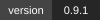
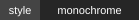
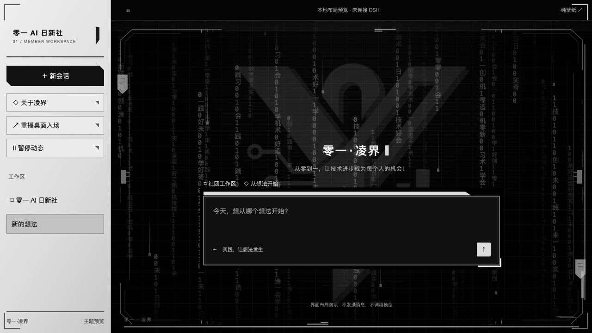
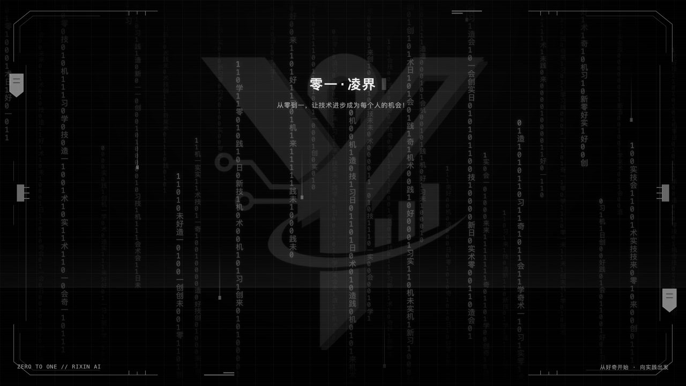

<div align="center">

<h1>◈ 零一·凌界</h1>

<p><strong>零一 AI 日新社 · 社员专属 DSH 黑白机械终端主题</strong></p>
<p>让每一次进入工作区，都成为从想法走向实践的起点。</p>

<p>
  
  
  
  
</p>

<p>
  <a href="#preview">🖼️ 效果预览</a> ·
  <a href="#features">⚙️ 主题特色</a> ·
  <a href="#install">📦 安装使用</a> ·
  <a href="#develop">🛠️ 本地开发</a>
</p>

</div>

---

**「零一·凌界」把社团的身份，放进每天使用的工作区。**

黑白数据雨缓缓穿过终端网格，机械滑块沿边轨往复运动，银白侧栏与低亮度社团徽记共同构成一个熟悉的桌面。它既是一张动态壁纸，也是一套覆盖 DSH 侧栏、输入区、菜单和设置的主题。

> **从零到一，让技术进步成为每个人的机会！**

<a id="preview"></a>

## 🖼️ 效果预览

<p align="center">
  
</p>
<p align="center"><sub>桌面布局预览 · 与插件共用主题和壁纸代码，演示界面未连接 DSH，不调用模型。</sub></p>

<details>
<summary><strong>🌌 展开纯壁纸预览</strong></summary>

<p align="center">
  
</p>
<p align="center"><sub>独立浏览器实际截图。静态图片展示构图，完整动态请运行下方本地预览。</sub></p>

</details>

<a id="features"></a>

## ⚙️ 主题特色

| 组成 | 使用体验 |
| :--- | :--- |
| **🌧️ 分层数据雨** | 36 列二进制与社团汉字分为近、中、远三档速度，搭配 8 条快速数据光线。 |
| **⌁ 机械边轨** | 双侧滑块往复、上下导轨光线移动、锁扣周期性开合，保持锐利的几何结构。 |
| **◫ 黑白终端** | 细网格、CRT 扫描线、过扫光带与低亮度社团 Logo 水印；没有时钟组件。 |
| **↗ 桌面入场** | 原开场结束后，约 1.6 秒完成边框展开、扫描与数据接入，随后回到常驻动态。 |
| **▣ 全界面主题** | 银白侧栏、黑色阅读区、硬边输入框、菜单与设置采用统一的黑白灰层次。 |
| **⌨️ 工作优先** | 特效避开输入区、不拦截点击；进入对话后，背景淡化并暂停运动。 |

左上角使用纯文字社团标识，页面大标题居中。系统开启「减少动态效果」时使用静止画面，切到后台时暂停运动。

### 🎬 开场与桌面的衔接

**原开场完成 → 机械边框展开 → 数据雨短暂加速 → 桌面稳定运行。**

凌界不会添加另一段需要确认的开场，也不播放声音。动画期间可以直接输入；普通切页或调整窗口不会重复入场。没有启用开场插件时，首次进入工作台也会播放一次。

已针对社团的两套开场适配衔接：

- [⚙️ 零一·环轨启序](https://github.com/XiaoSiKe/zero-one-orbit-intro)
- [◈ 零一·棱光序章](https://github.com/XiaoSiKe/01-lingguang-prologue)

<a id="install"></a>

## 📦 安装使用

### 先下载

前往 **[Releases 下载页](https://github.com/XiaoSiKe/zero-one-lingjie-theme/releases/latest)**：

| 文件 | 用途 |
| :--- | :--- |
| `dsh-plugin-01-wallpaper-0.9.1.tgz` | DSH 插件安装包，包含生成后的客户端和本地资源。 |
| `Source code (zip)` | 完整源码，包含独立预览和开发脚本。 |
| `SHA256SUMS.txt` | 安装包完整性校验。 |

### 接入 DSH

1. 解压 `.tgz` 安装包，得到 `package/` 目录；或者下载并解压完整源码。
2. 在 DSH 左侧进入 **「插件 → 添加插件」**，选择解压后的 `package/` 或项目根目录。
3. 启用插件；若宿主提示重载，按提示重载或重启 DSH。

熟悉命令行的社员也可以使用 DSH 自带的 CLI：

```sh
dsh plugin --profile desktop add /完整路径/dsh-plugin-01-wallpaper-0.9.1.tgz
```

安装时保留 `lib/`、`package.json`、`cordis.patch.yml` 及许可文件。普通使用无需构建，也无需安装额外依赖。

> **已有测试版？** 正式显示名称是「零一·凌界」，内部包名继续使用 `dsh-plugin-01-wallpaper`，便于原位升级。不要同时启用两份凌界主题。

### 恢复原界面

在插件管理页停用或移除本插件。自有节点、样式、主题令牌、监听器和动画会被清理，原品牌与欢迎标题恢复。原有开场插件保持独立。

启用凌界期间，浅色、深色和跟随系统都采用本主题的黑白配色；不会改写用户保存的外观偏好。macOS 原生窗口按钮与系统屏幕共享提示仍由操作系统绘制。

<a id="develop"></a>

## 🛠️ 本地预览与开发

需要 **Node.js 22.19+**。项目没有运行时依赖，不需要 `npm install`。

```sh
git clone https://github.com/XiaoSiKe/zero-one-lingjie-theme.git
cd zero-one-lingjie-theme
npm start
```

打开 **[本地壁纸预览](http://127.0.0.1:4192/)**，或 **[桌面布局预览](http://127.0.0.1:4192/preview/desktop.html)**。

| 操作 | 方式 |
| :--- | :--- |
| 观察完整壁纸 | 点击「纯壁纸」，或按 `H` 隐藏控件；按 `Esc` 恢复。 |
| 查看入场效果 | 点击「重播桌面入场」。 |
| 切换静态画面 | 点击「动态：开／关」。 |
| 停止本地服务 | 在终端按 `Ctrl+C`。 |

```sh
npm run build                          # 生成 lib/client.js
npm run check                          # JavaScript 语法检查
npm pack --pack-destination dist       # 打包插件
```

<details>
<summary><strong>📁 源码导航与验证范围</strong></summary>

| 路径 | 内容 |
| :--- | :--- |
| `src/wallpaper.js` / `src/wallpaper.css` | 数据雨、机械边轨、水印与桌面入场。 |
| `src/theme.css` / `src/tokens.js` | 全界面样式与 107 个语义颜色令牌。 |
| `src/client.js` | DSH 挂载、开场衔接、输入避让与生命周期清理。 |
| `preview/` | 壁纸、桌面布局及浏览器验证页面。 |
| `scripts/build.mjs` | 内嵌本地 Logo、样式和脚本；插件运行时不请求远程素材。 |

启动本地服务后，可打开：

- `/preview/adapter-test.html`：40 项主题、动效、输入避让与清理检查。
- `/preview/entrance-test.html`：13 项开场衔接、重播抑制、加速恢复与播放中卸载检查。

发布前共 **53 项浏览器检查通过**。GitHub Actions 检查构建、语法以及生成文件的一致性；不将语法检查等同于真实桌面兼容性验收。

</details>

## 🧩 兼容性

| 环境 | 当前验证情况 |
| :--- | :--- |
| **macOS · DeepSeek Harness 0.2.1-rc.3** | 已实测主题显示、菜单、输入、侧栏折叠及棱光序章结束后的桌面返回。 |
| **独立浏览器预览** | 已验证壁纸与衔接效果；演示页面不连接账户、工作区或模型服务。 |
| **Windows / Linux / 其他 DSH 版本** | 尚未完成实机验收。 |

部分适配使用宿主 DOM 属性与 class 后缀；DSH 升级后可能需要调整。若遇到问题，欢迎提交 [Issue](https://github.com/XiaoSiKe/zero-one-lingjie-theme/issues)，附上系统、DSH 版本、主题版本与复现步骤。

## 🤝 来源与致谢

壁纸的数据雨生成与 CRT／网格／水印效果，改编自 **长征机 · [dsh-theme-longmarch](https://github.com/Soviet-Dreadnaught/dsh-theme-longmarch)**，原作者 **[@Soviet-Dreadnaught](https://github.com/Soviet-Dreadnaught)**，参考版本 v1.2.0。感谢其开源实现；原作者署名与 MIT 许可保留在 [第三方声明](THIRD_PARTY_NOTICES.md) 和 [许可文件](licenses/longmarch-MIT.txt) 中。

DSH 客户端挂载和主题令牌方案参考 [seaison/dsh-plugin-eva-theme](https://github.com/seaison/dsh-plugin-eva-theme)。凌界未使用其中的 EVA 角色、音乐或开场素材。

社团 Logo 与初心文字延续零一 AI 日新社已有项目。代码采用 [MIT 许可](LICENSE)，代码许可不授予社团名称和 Logo 的商标或品牌使用权。

---

<p align="center">
  <strong>零一 AI 日新社</strong><br>
  <sub>从零到一，让技术进步成为每个人的机会！</sub>
</p>
